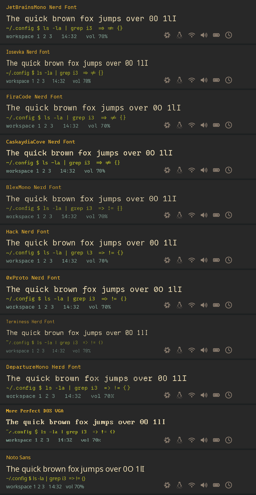

# tuxcraft

One script from a live ISO to a complete, themed, keyboard-driven Linux desktop —
**i3 (X11) or sway (Wayland)** on **Arch, Debian or Void**, with btrfs snapshots that
make a bad update a two-minute fix instead of a reinstall.

It asks a handful of questions, then does everything else: partitioning, base system,
drivers, desktop, TUI apps, fonts, colours, login screen, snapshots and a safe update command.
Configs come from [debi3n](https://github.com/plaintextlab/debi3n), cleaned up and made
distro-neutral.

## Quick start

Boot the live ISO of the distro you want, connect to the internet, then:

```sh
curl -fsSL https://raw.githubusercontent.com/plaintextlab/tuxcraft/main/install.sh | sudo bash
```

| Distro | Boot this | Notes |
|---|---|---|
| Arch | official `archlinux-*.iso` | Wi-Fi: `iwctl` |
| Debian | a **live** ISO (`debian-live-13-*-standard.iso`) — the netinst image has no shell to run scripts | installs the same release as the ISO |
| Void | `void-live-x86_64-*-base.iso` (glibc recommended; NVIDIA needs glibc) | Wi-Fi: `nmtui` or `wpa_supplicant` |

Already have a minimal install (e.g. Debian from the normal installer)? Run the same
command there: tuxcraft detects that it is not on a live ISO and only sets up the desktop
(snapshots are added too if `/` is btrfs).

## What it asks

1. **Disk** to erase (live ISO only), computer name, user, password, timezone, keyboard
2. **X11 + i3** or **Wayland + sway** — same keys, same look either way
3. **NVIDIA proprietary driver?** (only asked when an NVIDIA GPU is detected; Intel/AMD just work)
4. **Colour scheme** — Gruvbox, Everforest, Catppuccin Mocha/Latte, Nord, Tokyo Night, Rosé Pine, Kanagawa, Dracula, Motif
5. **Font** (previews below) and size
6. **Browser** and **optional extras** (Nemo, Flatpak, wallpapers, Bluetooth, music, printing, dev tools, office, gaming, paru)
7. Extra packages to **add**, packages to **leave out**

Answers are saved to `/etc/tuxcraft/answers.conf` (without the password); reuse them for an
identical machine with `sudo ./install.sh --config answers.conf --yes`.

## Fonts



Every choice gets Nerd Font icons through a fallback, so the bar and launcher look right even
with the DOS font. Change any time with **Super+Ctrl+F** or `tux-font set dos 13`.

## What you get

| Area | X11 session | Wayland session |
|---|---|---|
| Window manager | i3 | sway |
| Bar | polybar | waybar |
| Launcher / menus | rofi | fuzzel |
| Compositor | picom (v12 rules, animations) | built in |
| Lock / idle | i3lock + xss-lock | swaylock + swayidle |
| Wallpaper | feh | swaybg |
| Clipboard history | CopyQ | cliphist |
| Screenshots / recording | maim, ffmpeg | grim, slurp, wf-recorder |
| Monitors | autorandr / arandr | kanshi |

Shared by both: **Alacritty**, dunst, PipeWire, NetworkManager, polkit agent, gnome-keyring,
udiskie, gammastep (night light), xdg portals, Papirus icons, adw-gtk3.

**Login screen:** greetd + **tuigreet** — a TUI login that fits a keyboard-driven setup, works with
X11 and Wayland, systemd and runit, and is coloured by the system theme (the console palette is
themed too). LightDM is used only if tuigreet is not packaged.

**TUI apps:** yazi (files), btop, lazygit, nmtui, bluetui, wiremix/pulsemixer, ncdu, micro + neovim,
fzf, bat, eza, fd, ripgrep, zoxide, starship, fastfetch, calcurse, qalc, tealdeer, tmux, ncmpcpp.

## One theme, everywhere

`tux-theme` renders a single palette into i3/sway, polybar/waybar, rofi/fuzzel, dunst, Alacritty,
GTK 3 (adw-gtk3), GTK 4/libadwaita, **Qt 5/6 (qt5ct/qt6ct, Fusion + the same palette, so Qt and
GTK apps match)**, btop, micro, starship, fzf, zathura, swaylock, the wallpaper, the login screen
and the TTY. Switch with **Super+Ctrl+T** or `tux-theme set nord`.

Own palette: copy any file from `/usr/share/tuxcraft/themes/` to `~/.config/tuxcraft/themes/`,
edit the colours, `tux-theme set <name>`.

## Not breaking the system

| Layer | What happens |
|---|---|
| btrfs layout | `@`, `@home`, `@snapshots`, `@var_log`, `@var_cache`, `@var_tmp`; zstd compression |
| Automatic snapshots | hourly timeline of `/` and `/home` (snapper), pruned automatically |
| Package snapshots | before/after every pacman (snap-pac) / apt (hook) / `sysup` (Void) transaction |
| Boot a snapshot | GRUB → *tuxcraft snapshots* (grub-btrfs) |
| Roll back | `tux-snap rollback <n>` → reboot. `/home` is never touched |
| Updates | `sysup` (Super+U): battery/space checks, **Arch news gate**, update, flatpaks, cache cleanup, `.pacnew` report, reboot hint |
| Fallback kernel | Arch installs `linux` **and** `linux-lts` |
| Debian | security updates install themselves; everything else waits for `sysup` |
| Off-disk backups | `tux-backup` → incremental `btrfs send` to an external btrfs drive (rsync for other filesystems) |
| `rm` | aliased to `trash-put` in the shell (`rmf` for the real thing) |

Snapshots live on the same disk. They protect against bad updates and mistakes, **not** against a
dead SSD — that is what `tux-backup` is for.

### Recovering from a bad update
1. Reboot, pick **tuxcraft snapshots** in GRUB, choose a snapshot from before the update.
2. Log in (the snapshot is read-only, that's fine), run `tux-snap` to see the list, then
   `tux-snap rollback <n>` and reboot.
3. Later: `tux-snap clean` removes the broken root that was set aside.

## Keys (Super = Windows key)

`Super+K` shows the complete list. The essentials:

| Keys | Action | Keys | Action |
|---|---|---|---|
| Super+Enter | terminal | Super+D | launcher |
| Super+Space | window switcher | Super+Q | close |
| Super+E / Shift+E | yazi / Nemo | Super+B | browser |
| Super+Escape | **system menu** | Super+U | **update (sysup)** |
| Super+V | clipboard history | Print / Super+Print | screenshot / capture menu |
| Super+Ctrl+T / F / W | theme / font / wallpaper | Super+Ctrl+N / B / A / M | network / bluetooth / audio / btop |
| Super+Shift+L | power menu | Super+Alt+L | lock |
| Super+1..0 | workspaces | Super+Shift+1..0 | move window |
| Super+F | fullscreen | Super+Shift+Space | float / tile |
| Super+T | notes | Super+A | web apps |

## Commands

| Command | Does |
|---|---|
| `sysup` | the one safe way to update |
| `tux-snap` | list / create / diff / restore a file / rollback / clean |
| `tux-backup [mountpoint]` | backup to an external drive |
| `tux-theme`, `tux-font`, `tux-wallpaper` | look & feel |
| `tux-pkg install/remove/search` | the same package words on every distro (`ii`, `rr`, `ss` aliases) |
| `tux-control` | the system menu from a terminal |

## Your own changes

- `~/.config/i3/local.d/*.conf`, `~/.config/sway/local.d/*.conf` — your WM tweaks, never overwritten
- `~/.bashrc.local` — your shell additions
- Re-running the installer moves any config it would overwrite to `~/.local/state/tuxcraft/backup-<date>/`

## Honest limitations

- **Tested so far:** every script passes shellcheck; all ten themes are rendered and every generated
  TOML/INI/XML/Qt palette is parsed; the Void package names were checked against void-packages.
  **Not yet tested:** a full install on real hardware or a VM for each distro. Treat the first runs
  as beta and keep the log (`/var/log/tuxcraft.log`).
- No disk encryption (LUKS) yet, and the installer always uses the whole disk (no dual-boot partitioning).
- x86_64 only. Arch + NVIDIA Pascal or older needs the AUR `nvidia-580xx` driver (the script tells you).
- A missing package never stops the install: it is skipped and listed at the end.
